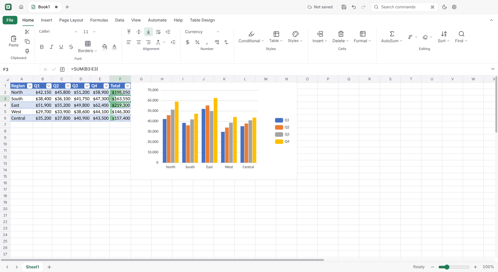
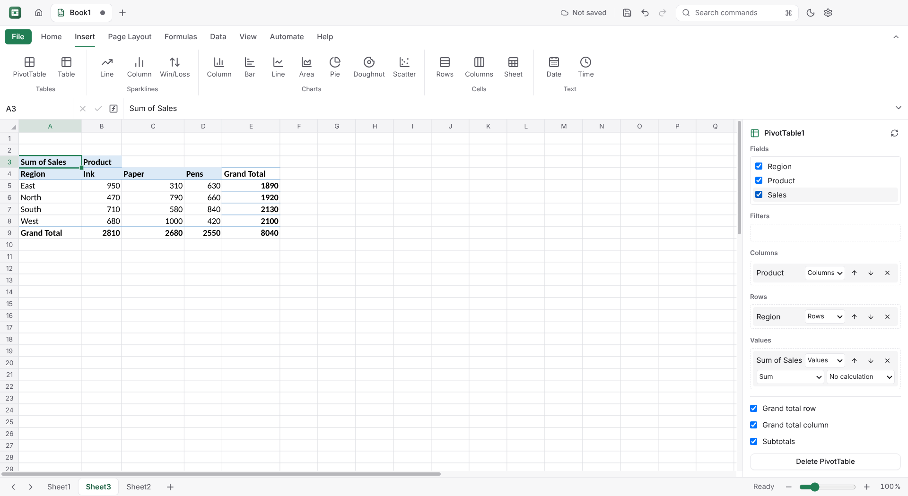

# Simple Cell

A fast, private spreadsheet for Windows, macOS and Linux that opens and saves Excel and OpenDocument workbooks. It works offline, with no account and no telemetry. Part of the Simple family of apps.



> **Early development (0.2.0).** Simple Cell does **not** claim full Excel compatibility. What works, with the tests that prove it, is listed in [IMPLEMENTATION_STATUS.md](IMPLEMENTATION_STATUS.md), and Excel compatibility is tracked feature by feature in [docs/EXCEL_COMPATIBILITY.md](docs/EXCEL_COMPATIBILITY.md).

## Install

Download the file for your system from the [latest release](https://github.com/fleetwoodjohnr/simple-cell/releases/latest).

| System | File | How to install |
|---|---|---|
| **Windows** 10 and 11 (x64) | `Simple-Cell-Setup-<version>.exe` | Run the installer. |
| **macOS**, Apple Silicon | `Simple-Cell-<version>-arm64.dmg` | Open the .dmg and drag Simple Cell to Applications. |
| **macOS**, Intel | `Simple-Cell-<version>.dmg` | Open the .dmg and drag Simple Cell to Applications. |
| **Ubuntu, Debian** | `simple-cell_<version>_amd64.deb` | `sudo apt install ./simple-cell_<version>_amd64.deb` |
| **Fedora** and other rpm systems | `simple-cell-<version>.x86_64.rpm` | `sudo dnf install ./simple-cell-<version>.x86_64.rpm` |
| **Any Linux** | `Simple-Cell-<version>.AppImage` | `chmod +x Simple-Cell-*.AppImage`, then run it. |

**First launch.** The builds aren't signed with a paid certificate yet, so the system warns the first time you open them:
- **Windows** (SmartScreen, "Windows protected your PC"): click **More info**, then **Run anyway**.
- **macOS** ("can't be opened" or "is damaged"): open **System Settings ▸ Privacy & Security** and click **Open Anyway**. Or run this in Terminal:
  ```bash
  xattr -dr com.apple.quarantine "/Applications/Simple Cell.app"
  ```

**Updates.** Simple Cell checks for a new version at most once a day and asks before it downloads anything. Turn this off in **Settings ▸ Updates**. On macOS it opens the release page instead of updating itself.

## What it does

- **A grid that keeps up.**
  - Scrolls smoothly to Excel's limits of 1,048,576 rows × 16,384 columns.
  - Types numbers, dates, percentages and currency with Excel's automatic formats.
  - Formula bar, Name Box, multiple sheets, and undo for every edit.
- **Formulas.**
  - 499 of Excel's 526 worksheet functions, checked against Microsoft's documented examples and LibreOffice ([docs/FORMULA_COVERAGE.md](docs/FORMULA_COVERAGE.md)).
  - Dynamic arrays that spill, LET and LAMBDA, names, cross-sheet references, and circular reference detection.
- **Formatting.**
  - Fonts, colours, borders, alignment, wrapping, merging, number formats and cell styles.
  - Format Painter and Paste Special.
  - **AutoFit row height and column width** (Home ▸ Format, or double-click a row or column border) sizes rows and columns to their contents.
- **Conditional formatting.** Highlight rules, top/bottom rules, colour scales, data bars, icon sets and formula rules.
- **Tables and filters.** Ctrl+T tables with styles and a total row; filters by value, condition or top N.
- **Charts and sparklines.**
  - Column, bar, line, area, pie, doughnut and scatter charts, created from a range with Alt+F1, then edited, printed, and saved in .xlsx files.
  - Line, column and win/loss sparklines.
- **PivotTables and analysis.**
  - PivotTables with a field list.
  - Remove Duplicates, Text to Columns and Flash Fill.
  - Goal Seek, Solver, Data Tables, the Scenario Manager and Descriptive Statistics.

  

- **Data validation.** Dropdown lists, number, date, text-length and formula rules, input messages and error alerts.
- **Notes and links.** Cell notes and hyperlinks.
- **Printing and PDF.** Page setup, print areas and titles, page breaks, headers and footers, fit to page, a preview, and Save as PDF.
- **Macros.** JavaScript macros in a sandbox that can only touch the workbook, with a trust prompt for macros that come from files. VBA in .xlsm files is kept and can be read, but never runs ([docs/MACRO_SECURITY.md](docs/MACRO_SECURITY.md)).
- **SQL.** Query named tables or selected datasets with SQLite (Automate ▸ SQL). UPDATE, DELETE and INSERT edit source data; returned rows go to a new sheet or an output range. Preview changes nothing; Run is one undo step. Queries can be cancelled and stop after 30 seconds. See [SQL guide](docs/SQL.md).
- **Keyboard first.**
  - Excel's keyboard shortcuts, KeyTips (Alt), a command palette, and a Google Sheets shortcut preset ([docs/SHORTCUT_REFERENCE.md](docs/SHORTCUT_REFERENCE.md)).
  - Light and dark themes.
- **Files.**
  - Excel (.xlsx, .xlsm, templates) and OpenDocument (.ods), read and written by Simple Cell itself. Content it can't show yet is kept and saved unchanged.
  - CSV, TSV, JSON, HTML tables and XML Spreadsheet 2003.
  - .xls when LibreOffice is installed.
  - Details: [docs/FILE_FORMAT_SUPPORT.md](docs/FILE_FORMAT_SUPPORT.md).
- **Safety.**
  - AutoSave and crash recovery.
  - Before saving to a format that would lose content, it warns you and offers to save as .xlsx instead.

## Build from source

You need Node 24.

```bash
npm ci
npm run dev    # run with hot reload
npm run dist   # build the installers for this OS into release/
```

- [CONTRIBUTING.md](CONTRIBUTING.md): the project's conventions.
- [ARCHITECTURE.md](ARCHITECTURE.md): how the app fits together.
- [docs/BUILD_AND_RELEASE.md](docs/BUILD_AND_RELEASE.md): tests, installers and releases.
- [docs/PERFORMANCE_BENCHMARKS.md](docs/PERFORMANCE_BENCHMARKS.md): measured performance.

## License

MIT. Bundled fonts are under the SIL Open Font License and Apache-2.0 (see [ARCHITECTURE.md](ARCHITECTURE.md)).
